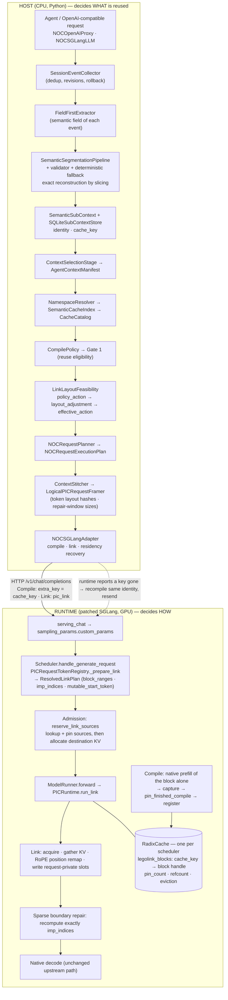

# Architecture

This page is the map: the data flow, what each module is responsible for, and the contract between the host and the runtime. For file/class/line
anchors see [CODE_MAP.md](CODE_MAP.md); for the runtime packaging see [RUNTIME.md](RUNTIME.md). Source code is the ground truth — where this page and the code
disagree, the code wins (and `tests/test_architecture_stage_map.py` fails if the stage map drifts from it).

## 1. The idea in five sentences

1. The host turns an agent session into byte-exact **semantic sub-contexts**, each with a content identity and a cache key.
2. For each sub-context it decides **compile** (a stand-alone prefill whose KV is registered under the key), **reuse** (already registered), or **mutable suffix**.
3. The plan has one fixed shape — *a prefix of linked blocks followed by one mutable suffix* — because that is all the runtime's link plan can express; a layout stage adjusts the policy's decisions until they fit and records every adjustment.
4. The runtime derives every physical consequence itself (block ranges, global positions, `imp_indices`, RoPE remap, KV slots), verifies the token layout the host asserts, pins the source blocks before it allocates, and fails closed.
5. Residency is the runtime's alone: the host catalog records *intent* and repairs it by a single-flight recompile when the runtime reports a planned block gone.

## 2. Data flow

A request, concretely:

1. **Ingress.** `terminal_bench_integration/noc_openai_proxy.py` accepts an ordinary Chat Completions request and hands it to `NOCSGLangLLM.call`; programs that drive the agent object directly (the example, the tests) call it themselves. Because the proxy owns the guardrail, replan loop, session keying and metrics, a client talking directly to an OpenAI endpoint is *not* an equivalent control — the proxy has a `passthrough_original_sglang` route for that.
2. **Events → fields → segments.** `session.py` turns messages and tool output into `SessionEvent`s; `FieldFirstExtractor` assigns each a semantic field; `SemanticSegmentationPipeline` (deterministic by field by default; an LLM segmenter is optional) proposes spans, `SemanticSegmentationValidator` checks exact coverage, and the text is rebuilt by slicing — the segmenter never returns replacement text.
3. **Sub-contexts.** `SemanticSubContext.create` computes `semantic_identity` (token ids + field; no task or agent) and `semantic_cache_key` (identity + field + model/tokenizer fingerprints + segmentation and recompute policy versions), and stores them transactionally.
4. **Selection.** `ContextSelectionStage` builds an `AgentContextManifest` (a logical selection with no cache state).
5. **Planning.** `NOCRequestPlanner.plan`: namespace/alias lookup → compile policy (`legacy_fixed_64`, the default) → persistence rules → Gate 1 (is the cached state canonical?) → link-layout feasibility → effective decisions. Each block records `provisional_action`, `policy_action`, `layout_adjustment` and `effective_action`; layout never rewrites the economics.
6. **Compile on miss.** For each planned block whose key is not resident the adapter sends an ordinary request with `max_tokens=1` and `extra_key = cache_key`, carrying the block's authoritative token ids. The runtime prefills the block alone and registers its KV in the RadixCache under that key.
7. **Link.** The adapter sends one request whose `pic_link` names the cache keys in order, the repair-window sizes, and the token-layout hashes. The runtime validates it, re-derives the physical plan, reserves and pins the sources, allocates request-private KV, copies the blocks' KV, re-rotates K from the block-local to the new global positions, **recomputes only `imp_indices`** (the chat prefix, the first K tokens of each block, fresh gap tokens, and the whole mutable suffix) with sparse causal attention over the linked KV, and returns the final-row logits.
8. **Decode.** Every later step is the ordinary upstream `forward_decode`. The linked KV is request-private and freed by the normal request lifecycle; the registered blocks are never written (the experimental *group promotion* path, off by default, is the only exception).
9. **Recovery.** If the runtime's source preflight reports keys missing/stale/incompatible, it attaches a structured JSON detail to the abort. The adapter claims one recovery per `(runtime, cache key)` (`ResidencyRecoveryCoordinator`, in-process single flight), recompiles the block under the same identity, and resends the Link. Recovered work is counted as Compile work, never as reuse.

## 3. The host/runtime contract

> **HOST decides WHAT semantic context / KV should be reused. RUNTIME decides HOW KV is physically allocated, positioned, linked, repaired, recomputed and decoded.**

| Sent by the host (`PIC_LINK_REQUEST_FIELDS`, 36 names in 8 groups) | Derived by the runtime (`PIC_LINK_RUNTIME_OWNED_FIELDS`, **refused if sent**) |
| --- | --- |
| identity (`request_id`, `task_id`, `variant`, …), selection (`cache_keys`, `block_ids`), compatibility (`adapter_id`, `segmentation_policy_version`, `legolink_policy_version`), repair-window **sizes** (`recompute_mode`, `recompute_tokens_per_block`, …), the authoritative token layout and its SHA-256s (`physical_input_ids`, `physical_block_segments`, `physical_token_ids_sha256`, `expected_complete_*`, …), governance (`execution_mode`, `framing_spec`, `repair_decision`), diagnostic and experimental flags | `block_ranges`, `attention_ranges`, `imp_indices`, `kvlink`, `recompute_positions`, `mutable_start_token`, `mutable_token_count`, `total_token_count`, `token_layout_source` |

* The runtime calls its own `validate_pic_link_request` first thing in `_prepare_link`, re-derives all nine fields from its registry's own tokens, and **checks rather than trusts** the host's token counts and hashes. KV slots, global positions and RoPE deltas never appear on the wire in either direction.
* The two field lists are defined twice (`noc_context_manager/pic_link_contract.py` and `pic_runtime.py`) because the host cannot import the Linux-only runtime. `tests/test_pic_link_contract.py` loads the runtime file by path and pins them equal; `scripts/verify_runtime.py` repeats that comparison against an installed runtime.
* `noc_context_manager/sglang_bridge.py` is a **legacy** plan-file helper that *does* build `imp_indices`/`kvlink`/`block_ranges`. It is not on the serving path (`sglang_adapter.py` never imports it) and the current runtime would reject its output; it is kept only because a contract test compares its output with the adapter's. Do not build on it.
* **Original SGLang is never an internal fallback of the strict patched server.** With `SGLANG_PIC_LEGOLINK_ONLY=1` the patched server refuses plain generation (`scripts/check_server.py --role patched` verifies it); baselines run on a separately launched, unmodified server.

## 4. Namespaces and the RadixCache

There is **one** physical RadixCache (one allocator, one KV pool) per scheduler process. The runtime registry `RadixCache.legolink_blocks` is keyed by a single string, the `cache_key`.
*Namespaces* (`instruction`, `tool_schema`, `conversation`, `tool_output`, `workspace`, plus the never-persistent `mutable_current_turn` and `no_cache`) are **host-side names** over that one registry, with three modes (`global`, `hard_namespace`, `logical_namespace`) and *alias* views that let a block stand in for another block with identical KV. "Multiple RadixCaches" — one physical tree per namespace — is a design under study, not code ([logical_radix_roots.md](logical_radix_roots.md), [semantic_cache_namespaces.md](semantic_cache_namespaces.md)).

## 5. Routes

| `PipelineRoute` | Server | Path |
| --- | --- | --- |
| `full_context_original_sglang` (A) | original | native prefill/decode, full text |
| `selected_context_original_sglang` (B) | original | native, NOC-selected text |
| `selected_context_radixcache_legolink` (C) | **patched** | Compile + Link + native decode |
| `passthrough_original_sglang` | original | the proxy's control arm: same messages, same guardrails, no NOC selection |

## 6. Status of the parts

* **Implemented and covered by the CPU tests here:** the host stages above; namespaces/aliases; residency catalog coherence and single flight; the runtime's block registry (register/lookup/acquire/pin/release/evict), link math (KV relocation, RoPE remap, write-back), admission and reservation lifetime, Compile race guard, and the security hardening of the `pic_link` input (patch 0028).
* **Experimental (flag-gated, not the default path):** `cost_benefit` compile policy (no hardware profile ships, so it refuses to run without one), Current-LLM segmentation, indexed mixed prefill, group promotion, admit-Link-while-decoding, FlashInfer and Triton sparse-repair/link paths.
* **Legacy, kept for a reason:** `legacy_fixed_64` (the baseline the cost-benefit policy must be compared against — do not delete), `sglang_bridge.py` (see §3), `NOCRequestScheduler` (deprecated alias of the planner).
* **Not implemented:** multiple physical RadixCaches; a link plan with arbitrary compile/mutable interleaving (LinkPlan v2); cross-process single flight.

## 7. State and lifetime (summary)

| State | Scope | Notes |
| --- | --- | --- |
| `SessionEventCollector`, `SQLiteSubContextStore` | one agent session | `ingest` checkpoints and rolls back on any failure; the store is transactional |
| `CacheCatalog` / `PersistentCacheCatalog` | adapter / append-only JSONL file | per-key lock held across a Compile; a failed Compile writes nothing; the JSONL is read by whole lines only |
| `ResidencyRecoveryCoordinator` | process singleton | keyed by `(runtime endpoint, cache key)`; every claimed flight ends, also on exceptions |
| `ProxySessionRegistry` | proxy process | an ambiguous continuation starts a new isolated session instead of reassigning one |
| `PICRequestTokenRegistry`, `RadixCache.legolink_blocks` | scheduler process | single scheduler thread; pins and refcounts are released in a `finally`; duplicate registration with equal content keeps the resident entry |

More: [KNOWN_LIMITATIONS.md](KNOWN_LIMITATIONS.md).
